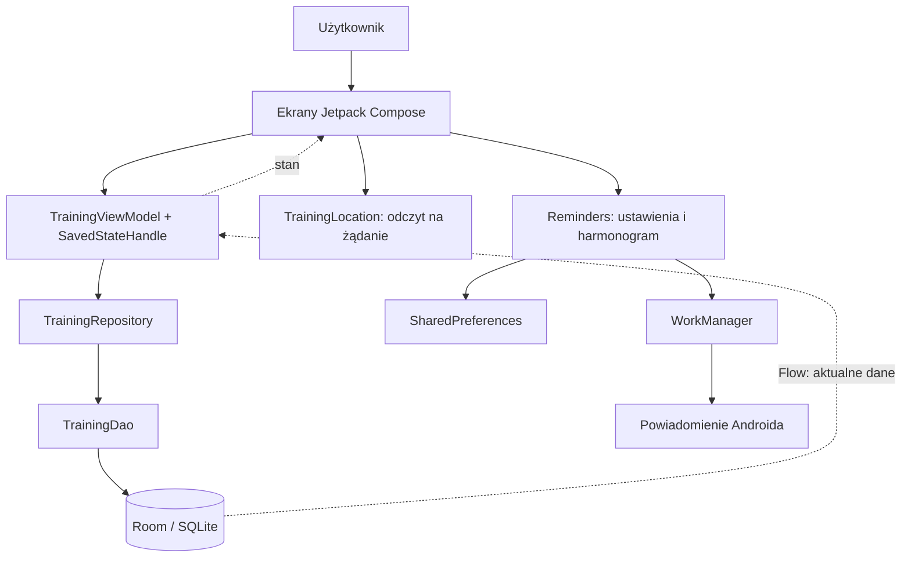
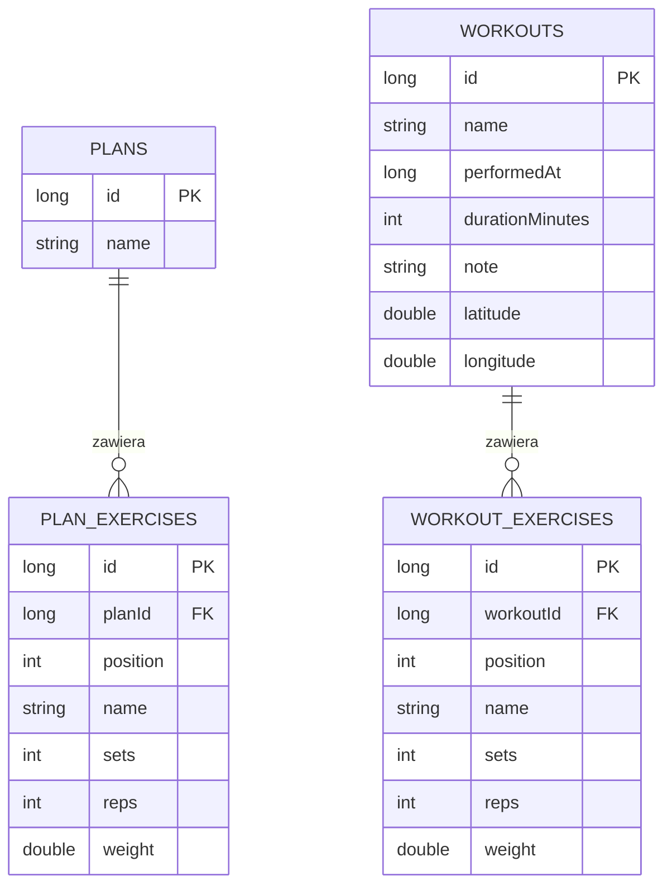
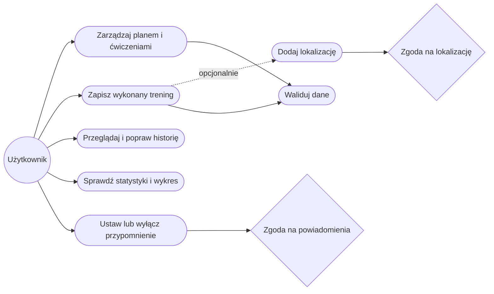

# Architektura i model danych

## MVVM

Ekrany renderują stan i przekazują akcje. ViewModel przechowuje formularz, kontroluje walidację, zapis i komunikaty. Repository oddziela interfejs od bazy oraz zapisuje cały plan/trening w transakcji. DAO zawiera zapytania. Room generuje implementacje, sprawdza zapytania i udostępnia Flow. Coroutines utrzymują operacje bazy poza głównym wątkiem. Ustawienia przypomnień i lokalizacja są małymi integracjami, bez dodatkowej warstwy serwera.

SavedStateHandle zapisuje formularz jako krótki JSON. Limit 30 pozycji, 60 znaków nazwy i 500 znaków notatki ogranicza rozmiar stanu. Po obrocie ekranu ViewModel nadal istnieje; zapis stanu umożliwia również odtworzenie formularza po odtworzeniu procesu przez system. Test automatyczny pokrywa odtworzenie Activity i round-trip JSON, a nie każdy wariant ubicia procesu przez producenta telefonu.

## Diagram bazy

Nie ma klucza obcego z treningu do planu: zapis wykonania jest kopią danych, dzięki czemu historia nie zmienia się po zmianie planu. Usuwanie planu usuwa tylko jego pozycje (CASCADE); usuwanie treningu analogicznie usuwa tylko jego pozycje. Indeksy na kluczach obcych ułatwiają odczyt relacji. Kolejność pozycji określa `position`. `performedAt` przechowuje czas w milisekundach, wyświetlany jako lokalna data. Współrzędne są opcjonalne i muszą występować parami.

Baza w wersji 1, schemat JSON w repozytorium. Nie stosujemy destrukcyjnej migracji. Przy przyszłej zmianie schematu trzeba zwiększyć wersję i dodać migrację oraz jej test.

## Przypadki użycia

1. Plan: użytkownik podaje nazwę i ćwiczenia, aplikacja waliduje pola i zapisuje transakcję.
2. Wykonanie: użytkownik wybiera plan, koryguje rzeczywiste wartości, ustawia datę/czas i zapisuje niezależny trening.
3. Historia: użytkownik odczytuje zapis, edytuje go lub potwierdza trwałe usunięcie.
4. Postępy: aplikacja liczy sumy i przedstawia objętość ostatnich siedmiu treningów, od najstarszego po lewej.
5. Lokalizacja: po zgodzie następuje jednorazowy odczyt; brak zgody, dostawcy lub wyniku daje komunikat i nie blokuje zapisu treningu.
6. Przypomnienie: użytkownik wybiera porę i aktywuje jeden unikatowy harmonogram; worker publikuje powiadomienie tylko przy aktywnych ustawieniach i zgodzie systemu.

## Walidacja
- Nazwa planu, treningu i ćwiczenia: 1–60 znaków po obcięciu skrajnych spacji.
- Od 1 do 30 pozycji, 1–50 serii, 1–200 powtórzeń.
- Ciężar: 0–1000 kg; przecinek i kropka dziesiętna, odrzucenie NaN i nieskończoności.
- Czas: 1–600 minut; notatka do 500 znaków.
- Edytor daty nie pozwala wybrać przyszłego dnia.
- Współrzędne muszą być skończone i mieścić się w granicach szerokości/długości geograficznej.

Walidacja występuje w formularzu oraz ponownie w repozytorium. Parametryzowane zapytania Room ograniczają ryzyko wstrzyknięcia SQL. Komunikaty nie ujawniają wewnętrznych wyjątków bazy.
