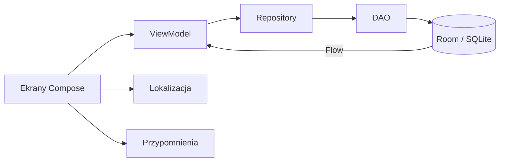
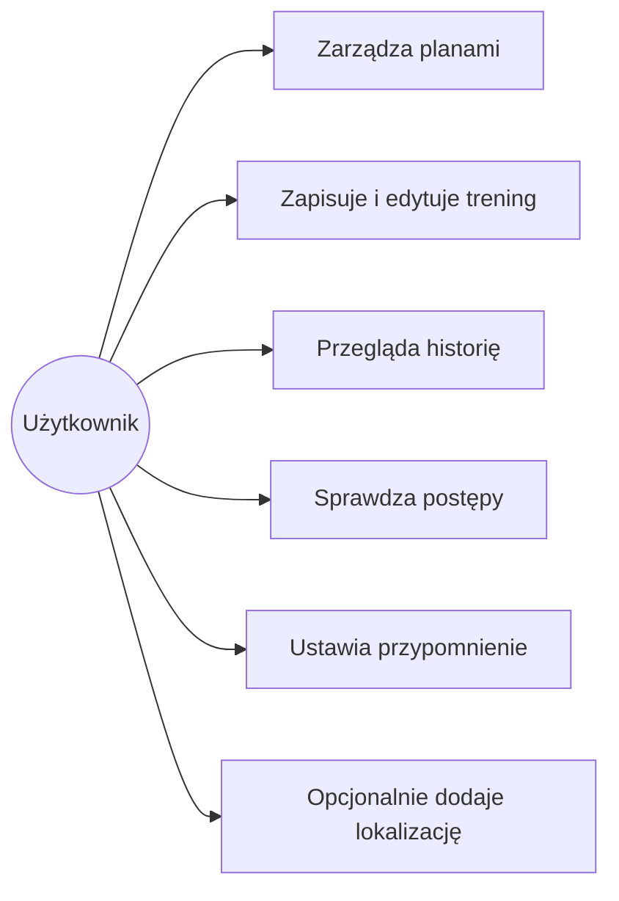

# Architektura i baza danych

Aplikacja używa Kotlin, Jetpack Compose, Material 3, MVVM, Room/SQLite, Coroutines i Flow.

## Przepływ danych



Ekrany obsługują interakcje, ViewModel zarządza stanem, a Repository zapisuje plany i treningi w bazie. Zapis powiązanych danych odbywa się w transakcji.

## Baza danych

```mermaid
erDiagram
    PLANS ||--o{ PLAN_EXERCISES : zawiera
    WORKOUTS ||--o{ WORKOUT_EXERCISES : zawiera
    PLANS { int id PK; string name }
    PLAN_EXERCISES { int id PK; int planId FK; int position; string name; int sets; int reps; double weight }
    WORKOUTS { int id PK; string name; long performedAt; int durationMinutes; string note; double latitude; double longitude }
    WORKOUT_EXERCISES { int id PK; int workoutId FK; int position; string name; int sets; int reps; double weight }
```

Trening przechowuje własną kopię ćwiczeń, więc późniejsza zmiana planu nie zmienia historii.

## Główne działania

Użytkownik może zarządzać planem, zapisać trening z planu lub bez niego, poprawić historię, sprawdzić statystyki, ustawić przypomnienie albo dodać bieżącą lokalizację.



## Walidacja

Aplikacja sprawdza nazwy, serie, powtórzenia, ciężar, czas treningu, notatkę i współrzędne. Nieprawidłowe wartości są odrzucane i pokazywany jest komunikat.
